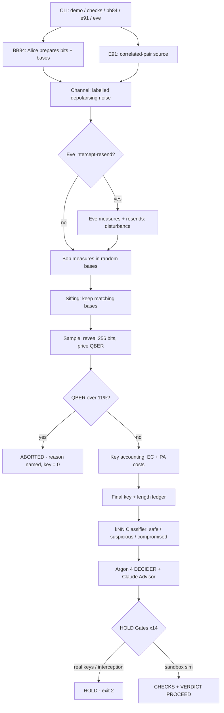
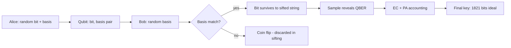
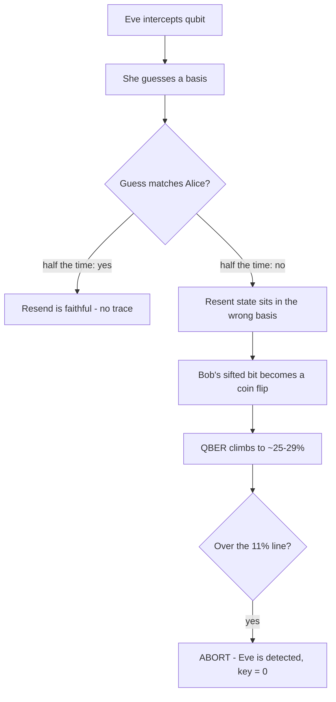
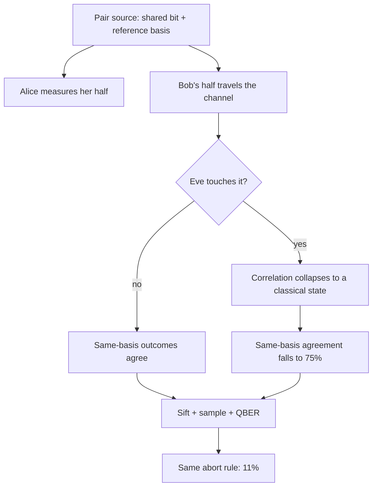
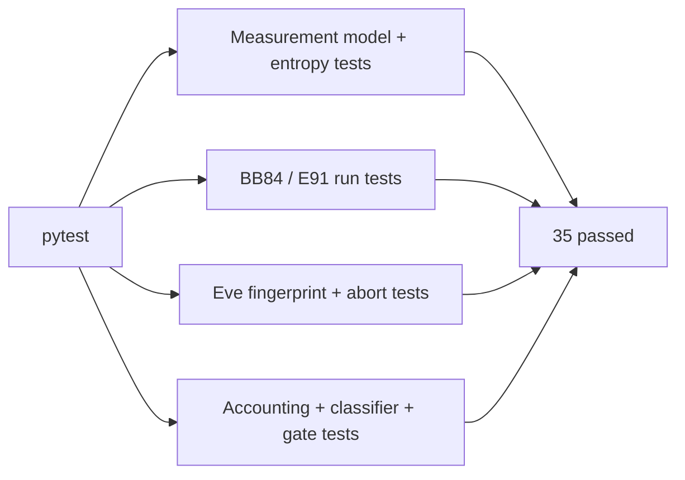
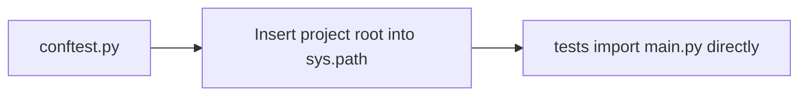
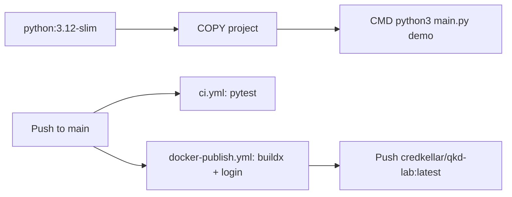

# QKD-Lab 🔐⚛️

**Quantum Key Distribution Lab** — by Darion Kellar

QKD-Lab is an **educational quantum key distribution lab** in ONE pure-Python file. It runs the **BB84 protocol end-to-end** — Alice prepares random bits in random bases, Bob measures in random bases, the matching-basis events are **sifted**, a revealed sample prices the **QBER**, and the surviving string is distilled through **error-correction and privacy-amplification accounting** into a final key whose length is printed, not promised. A **BBM92-style E91 variant** swaps Alice's preparation for a correlated-pair source, and an **Eve intercept-resend attack** is built in as a first-class citizen: she measures everything, resends what she measured — and the QBER jumps to **28.91%**, tripping the **11% abort line** and distilling **nothing**.

The honest scope is the whole point, and it is stated everywhere:

- ✅ **What is real:** the protocol logic. Measuring in the wrong basis disturbs the state; the disturbance is measurable as QBER; above the threshold the only secure move is to abort. The key-shrink ledger — sift, sample, error correction, privacy amplification — is computed in the open for every run.
- 🚫 **What is not real:** the photons. A "qubit" here is a classical `(bit, basis)` pair and measurement is a rule, not a detector. No key this lab prints is secret, and nothing here protects a real message.

Every real-key, secrecy-claim, interception, military / government / banking / medical / infrastructure use sits behind a permanent HOLD gate (14 total). 🔒

[](https://github.com/kimanicollier44-cmyk/QKD-Lab/actions/workflows/ci.yml)
[](https://github.com/kimanicollier44-cmyk/QKD-Lab/actions/workflows/docker-publish.yml)

> ℹ️ These are the **live** workflow badges for this repo. They activate as soon as the `ci.yml` and `docker-publish.yml` files from the paste pack are pasted into `.github/workflows/` — until then they have nothing to report yet.

## 🧰 Tech Stack Badges & Full Architecture Tech Stack

### 💻 Core Programming Languages & Core Systems


- 🐍 Python 3.12, pure standard library (`hashlib`, `json`, `math`, `random`, `sys`) — zero dependencies, zero network, deterministic (seeded runs, double-run byte-identical)
- ⚛️ Classical measurement model stated in the open: a qubit is a `(bit, basis)` pair; measuring in the wrong basis returns a coin flip and replaces the state — the disturbance Eve cannot avoid
- 📉 Shor–Preskill key accounting: error correction leaks `f · h2(q)` per bit (labelled f = 1.15), privacy amplification burns `h2(q)` per bit, and the 11% abort line is where `1 − 2·h2(q)` reaches zero
- 🧠 TinyML kNN run classifier (from scratch, stdlib): safe / suspicious / compromised from (QBER, sift rate, sample size), labels generated by the protocol's own security policy
- 🪑 Council seats: Gemini Argon 4 DECIDER (names-only, tighten-only) + Muse advisor (never overrides HOLD) + Google Flow plan-only (rendered = False, live = 0)

### ⛓️ Web3 & Infrastructure

- 🚫 **Not applicable — honestly.** No blockchain, no Web3, no tokens: the "infrastructure" in this lab is a labelled simulation of a quantum channel, an eavesdropper, and a distillation ledger inside one offline file. No fake badges here.

### ⚙️ Platform Support & Hardware Architecture


- 🖥️ Pure Python — runs anywhere Python 3.12+ runs (Linux, macOS, Windows), plus the `python:3.12-slim` Docker image
- 🔒 No hardware is controlled, ever: real QKD transmitters, single-photon sources, and detectors are permanent HOLD gates (see the gate table below)

### ⚡ Low-Level Infrastructure & Performance

- 🚫 **No low-level code — honestly.** No C, no C++, no GPU, no compiled extensions: this is one interpreted Python file on purpose, so every measurement, sift, and distillation step can be read, checked, and diffed. Performance here means honest algorithms — a single pass per protocol run, exact binary-entropy accounting, and a seeded RNG so every number replays byte-identically.

### 🛠️ DevOps & Build Tools


- 🐳 Docker (`python:3.12-slim`), GitHub Actions CI + Docker Publish (delivered in the paste pack)
- 🎯 Target image: `credkellar/qkd-lab:latest`
- 🧪 Tests: `pytest` (35 tests) + the built-in CHECKS suite (45 checks) in `main.py`

### ☁️ Cloud Providers

- 🚫 **None — honestly.** No cloud provider is used or needed: the lab runs fully offline on your own machine or in a local Docker container. Docker Hub appears only as the registry the publish workflow pushes the image to.

## What this does?

1. 🎲 **Alice prepares (BB84)** — 4,096 random bits in random bases (`+` rectilinear, `×` diagonal). Her basis choices are secret until the public comparison later — that ordering is the protocol, not a detail.
2. 📏 **Bob measures** — Bob picks his own random bases. Where his basis matches Alice's, his bit is hers; where it doesn't, his outcome is a coin flip and the event is doomed to be discarded — the measurement model is one small function you can read in full.
3. 🧹 **Sifting** — Alice and Bob announce bases (never bits) and keep only the matching events: **2,077 of 4,096** in the ideal run. Half the raw material is the price of the basis privacy that makes eavesdropping visible.
4. 🔍 **Parameter estimation** — the first 256 sifted bits are revealed aloud and compared: the mismatch rate is the **QBER**. On the ideal channel it is **0.00%**; with the labelled 2% depolarising noise it is **1.56%**. The revealed bits are then discarded — spoken secrets stop being secrets.
5. 🕵️ **Eve intercept-resend** — Eve measures every qubit in a random basis and resends what she measured. Half her guesses are in the wrong basis, and each wrong guess turns Bob's sifted bit into a coin flip: the sample QBER lands at **28.91%** — the textbook ~25% signature, measured, not asserted.
6. 🛑 **The abort rule** — above **11%** QBER the run is **ABORTED** with the reason named (`QBER_ABOVE_ABORT_THRESHOLD`) and the final key length is **0**. The threshold is not arbitrary: it is where the Shor–Preskill rate `1 − 2·h2(q)` reaches zero, so no distillation could leave Alice and Bob ahead of Eve.
7. 🔗 **E91 / BBM92 variant** — a source emits correlated pairs instead of Alice preparing states; same-basis outcomes agree, and Eve's interception collapses the correlation the same way (QBER **27.73%** → ABORTED). The model computes the pair statistics jointly — and says why: Bell's theorem forbids a local model from reproducing them.
8. 🧮 **Key accounting — the shrink** — every surviving run is itemised: raw → sifted → minus the revealed sample → minus error-correction leakage (`f · h2(q)`, f = 1.15 labelled) → minus privacy amplification (`h2(q)`). The noisy run pays **243 + 211 bits** and keeps **1,363**; the ideal run pays nothing and keeps **1,821**.
9. 💡 **Decoy-state note (labelled, not simulated)** — real transmitters fire weak laser pulses, and at mean photon number μ = 0.5 about **9.02%** of pulses carry 2+ photons Eve could split off silently (the PNS attack). The lab computes the Poisson surface and explains why decoy intensities exist — it does not pretend to simulate them.
10. 🏷️ **Run classifier + seats + checks** — a from-scratch kNN labels runs safe / suspicious / compromised with labels generated by the protocol policy itself (a clean run with a rushed 16-bit sample is *suspicious*: the estimate is too small to trust), watched over by the Argon 4 DECIDER (sha256 trace), Muse advisor, Google Flow plan-only, and a built-in CHECKS suite (45 checks).

## 🗺️ How it works — diagram per script

### `main.py` — the whole lab



### `main.py` § BB84 — one run, end to end



### `main.py` § Eve — information bought with errors



### `main.py` § E91 — the pair source



### `tests/test_main.py` — verification



### `conftest.py` — test path setup



### `Dockerfile` + CI flow — container & publish



## Why is this cool?

1. 🕵️ Eve is **in the box**: the attack is a runnable mode of the protocol, not a paragraph — flip her on and watch the QBER needle jump from 1.56% to 28.91%.
2. 🛑 The abort is **the feature**: the protocol's proudest moment is refusing to distil a key. Most crypto demos show success; this one shows the refusal, with the reason named.
3. 📉 The 11% line is **derived, not quoted**: it falls out of `1 − 2·h2(q) = 0`, and the checks pin `h2(0.11) ≈ 0.4999` so you can watch the rate die exactly at the threshold.
4. 🧮 The key **shrink is itemised**: 4,096 raw bits become 1,821 (ideal) or 1,363 (noisy) through four named cuts — sifting, sample, error correction, privacy amplification — each with its price printed.
5. 🔗 Two protocols, **one lesson**: BB84's prepare-and-measure and E91's pair source produce the same Eve fingerprint (~25–29% QBER), because the security was never in the hardware — it's in the disturbance.
6. 🧠 The E91 section teaches **Bell's theorem by confession**: the pair model must compute outcomes jointly, and the code says plainly that no local model can do what it just did.
7. 💡 The decoy note is **honest about its limits**: it computes the Poisson multiphoton surface (9.02% at μ = 0.5) and labels itself *not simulated* instead of faking a decoy protocol.
8. 🏷️ The classifier's labels come from the **protocol policy itself** — including the subtle one: a *clean* run with a 16-bit sample is suspicious, because a tiny sample can't certify a low QBER.
9. 🎲 Partial Eve is **priced too**: intercepting half the qubits lands the QBER between the noise floor and the full attack — the checks assert the ordering, so detection sensitivity is a curve, not a cliff.
10. 🎯 Deterministic end to end: seeded runs replay byte-identically — an eavesdropping experiment you can diff.

## What problems this solves?

1. ❌ **Problem:** QKD explainers say "eavesdropping is detectable" without showing the detection. ✅ **Solution:** Eve is a runnable attack mode; her wrong-basis measurements produce a measured 28.91% QBER and a named abort.
2. ❌ **Problem:** "Quantum-safe key" marketing hides how much key survives. ✅ **Solution:** The full shrink ledger is printed per run — raw, sifted, sample, EC, PA, final — so the surviving length is arithmetic, not adjectives.
3. ❌ **Problem:** The 11% QBER threshold is quoted like folklore. ✅ **Solution:** It is derived from the Shor–Preskill rate in the text and pinned by an entropy check at the threshold.
4. ❌ **Problem:** BB84 diagrams skip sifting and sampling as bookkeeping. ✅ **Solution:** Both are load-bearing here — sifting halves the string, and the revealed sample is discarded *because* it was revealed.
5. ❌ **Problem:** E91 is usually presented as magic entanglement dust. ✅ **Solution:** The pair model states its own cheat (joint statistics) and names Bell's theorem as the reason a local model can't reproduce it.
6. ❌ **Problem:** Noise and eavesdropping get conflated — "errors = hackers". ✅ **Solution:** The labelled 2% channel sits at 1.56% QBER and passes; Eve sits at ~29% and aborts. The threshold separates weather from adversary.
7. ❌ **Problem:** Error correction is treated as free. ✅ **Solution:** EC leakage is priced at `f · h2(q)` with the efficiency factor labelled — the noisy run pays 243 bits for it in the open.
8. ❌ **Problem:** Privacy amplification is a magic word at the end of talks. ✅ **Solution:** It is a line item — `h2(q)` bits per surviving bit, 211 bits in the noisy run — with the reason (erasing Eve's share) stated.
9. ❌ **Problem:** Decoy states get name-dropped with no numbers. ✅ **Solution:** The Poisson multiphoton probabilities are computed for μ = 0.1 / 0.5 / 1.0, and the note is labelled as a note — scope honesty instead of a fake implementation.
10. ❌ **Problem:** Simulation tools quietly imply a deployable product. ✅ **Solution:** 14 named HOLD gates return exit code 2 for every real-key, secrecy, interception, and deployment claim, forever.

## How to install this?

1. 📋 Clone or download this project folder:

```bash
git clone https://github.com/kimanicollier44-cmyk/QKD-Lab.git
```

2. 🐍 Make sure Python 3.12+ is installed: `python3 --version`
3. ▶️ Run the full demo + checks (no arguments needed):

```bash
python3 main.py
```

4. 🧪 Run the test suite:

```bash
pip install pytest
python3 -m pytest -q
```

5. 🎛️ Try the other commands:

```bash
python3 main.py checks    # 45 built-in checks
python3 main.py bb84      # BB84 ideal + labelled-noise runs (JSON)
python3 main.py e91       # E91/BBM92 clean + under-attack runs (JSON)
python3 main.py eve       # both protocols under intercept-resend (JSON)
python3 main.py keys      # all five canonical runs + key ledgers (JSON)
python3 main.py classify  # kNN run classifier report
python3 main.py brains    # Argon 4 + Muse + Flow seats
python3 main.py holds     # list all 14 HOLD gates
python3 main.py hold-demo # exits 2 - gated actions stay HOLD
```

6. 🐳 Or run it in Docker:

```bash
docker pull credkellar/qkd-lab:latest
docker run --rm credkellar/qkd-lab:latest
```

## Requirements

- 🐍 Python 3.12 or newer
- 📦 Dependencies: **none** (standard library only)
- 🌐 Network: **none** — fully offline
- 🧪 For tests only: `pytest`
- 🐳 Optional: Docker

## FULL project structure tree

```text
qkd-lab/
├── main.py                  # the whole lab: measurement model, BB84, E91/BBM92, Eve, key accounting, decoy note, classifier, seats, HOLD gates
├── conftest.py              # puts the project root on sys.path for tests
├── tests/
│   └── test_main.py         # 35 pytest tests: measurement, entropy, BB84/E91 runs, Eve abort, accounting, classifier, gates, seats
├── assets/
│   └── cover.png            # README cover image (2736 x 912)
├── .github/
│   └── workflows/
│       ├── ci.yml           # paste-in from the workflow pack
│       └── docker-publish.yml # paste-in from the workflow pack (tag: credkellar/qkd-lab:latest)
├── Dockerfile               # python:3.12-slim, runs the demo
├── .gitignore               # __pycache__/, .pytest_cache/, *.pyc
└── README.md                # this file
```

> 📦 Delivered separately as paste packs (not in this tree): `.github/workflows/ci.yml` + `docker-publish.yml`, and the Docker Hub pack (100-char description, 350-char About, overview, categories).

## 🔒 HOLD gates — all 14, permanent

| # | Gate | What stays held |
|---|------|-----------------|
| 1 | `production_key_generation` | No generating keys for production or real-world use; lab keys are simulated bits |
| 2 | `real_world_secrecy_claim` | No claim that a lab key is actually secret or safe to encrypt real data with |
| 3 | `intercept_real_communications` | No intercepting, monitoring, or tampering with real communications |
| 4 | `military_government_comms` | No military, government, or intelligence secure-communications use |
| 5 | `banking_financial_keys` | No generating or handling keys for banking, payments, or financial systems |
| 6 | `medical_communications` | No protecting real medical records or clinical communications |
| 7 | `critical_infrastructure_comms` | No securing power, water, transport, or other critical-infrastructure channels |
| 8 | `law_enforcement_comms` | No law-enforcement or emergency-services secure-communications use |
| 9 | `live_network_deployment` | No deploying this simulation on a live network as a key service |
| 10 | `real_qkd_hardware_control` | No control of real QKD hardware, single-photon sources, or detectors |
| 11 | `side_channel_attack_real_systems` | No side-channel or detector-blinding attacks on real QKD systems |
| 12 | `certified_security_claim` | No claim of certified or proven information-theoretic security for any real system |
| 13 | `espionage_surveillance_use` | No espionage, surveillance, or covert-interception use |
| 14 | `key_sale_or_service` | No selling keys, key material, or a key-distribution service |

🧑‍⚖️ **Council seats:** Gemini Argon 4 Extended Thinking — DECIDER (names-only, tighten-only, MAP → MODEL → STRESS → DECIDE, sha256 trace, `can_override_hold = False`) · Muse — advisor (`can_override_hold = False`) · Google Flow — plan-only (`rendered = False`, `live = 0`).

✅ **Verification:** pytest **35 passed** (project + clean copy) · built-in CHECKS **45/45** · double-run output **byte-identical** · `hold-demo` exits **2** · `main.py` **689 lines**, pure stdlib, zero network.

## 🧒 5th-grade English section

Imagine you and a friend pass secret notes using **flashlights and sunglasses**. 🔦

- You flash a light either **straight** or **tilted** — that's your secret way of writing 1s and 0s. Your friend watches either straight-on or tilted. When you both picked the *same* tilt, he reads your number perfectly. When the tilts differ, he sees a random blink — and you both throw those away. The ones that match become your **secret code**. 🤫
- Now a **sneaky kid** stands between you and peeks at every flash. But she has to guess a tilt to peek — and half the time she guesses wrong, which **scrambles the flash** before it reaches your friend. She can't copy the note without smudging it! 🕵️
- So every so often, you and your friend read a few numbers **out loud** and compare. If almost all match, the line is clean. If about **1 in 4** is wrong, you know someone is peeking — and you **throw the whole code away** and start over. Better no secret than a shared one. 🛑
- Even on a clean day, the code **shrinks**: you throw away the mismatched-tilt flashes, the ones you read out loud, and some extra to fix mistakes and to make sure the sneaky kid's peeking is useless. 4,096 flashes become a code about **1,821 numbers** long. That's the honest price of a secret. 🧮
- This project is a **pretend lab on a computer** — the "flashes" are just numbers in a program, not real light. But the *idea* is the real one scientists use: **you cannot listen to quantum messages without leaving fingerprints.** 💻

---

MIT © 2026 Darion Kellar · QKD-Lab — educational simulation only 🔐
